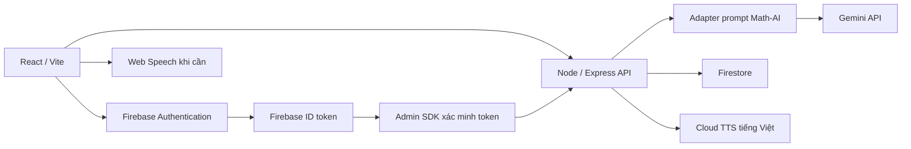

# Phân tích Math-AI và thiết kế hệ sinh thái Mathate

## 1. Kết luận

Math-AI có lõi sư phạm có thể tái sử dụng: tạo bài tự luận theo năng lực, gia sư gợi mở bốn bước, robot cảm xúc và giọng đọc tiếng Việt. Tuy nhiên, cấu trúc sản phẩm gắn với lớp học, bài khởi động, worksheet và kỳ thi. Mathate cần một miền dữ liệu riêng xoay quanh **người dùng → chủ đề → phiên luyện tập → tiến bộ**.

Đối tượng đã xác nhận: **6–11 tuổi, ưu tiên toán tiểu học**. Chọn độ khó thay cho chọn lớp. Admin chịu trách nhiệm định nghĩa phạm vi kiến thức và chỉ dẫn từng mức độ trong chủ đề.

## 2. Những phần đã đọc trong Math-AI

Đường dẫn trong bảng tính từ `D:/Math-AI/Math-AI`.

| Thành phần | Bằng chứng mã nguồn | Ý nghĩa cho Mathate |
|---|---|---|
| Phân hệ và điều hướng | `src/App.jsx`, các trang student/faculty/admin | Chỉ giữ người học và admin cho phạm vi ban đầu |
| Chủ đề | `src/models/Topic.js` có `gradeLevel` | Không đưa trường lớp/khối vào schema mới |
| Định tuyến AI | `src/services/serviceRouter.js` | Có 4 họ: mặc định, thập phân, tỉ số, chuyển động |
| Tạo đề | `src/services/gemini/geminiPracticeService*.js` | Dùng lại các hàm dựng prompt và hướng dẫn chuyên môn |
| Gia sư | `src/services/gemini/geminiChatService*.js` | Dùng lại `_buildSystemPrompt()`, chuyển trạng thái trên server |
| Chat UI | `src/components/PracticeChat.jsx` | Kế thừa luồng gợi ý, trạng thái, giọng đọc, nhập giọng nói; viết UI mới để bỏ phụ thuộc exam/resultService |
| Robot | `src/components/common/RobotCompanion.jsx` | Giữ model `scene.splinecode` và biến Mood 0/1/2 |
| TTS | `src/services/ttsService.js`, `api/tts.js` | Dùng backend WaveNet vi-VN nam/nữ và audioConfig gốc; không dùng giọng mặc định của thiết bị |
| Điểm | `src/services/scoringService.js` | Điểm thi có thưởng theo tốc độ; không phù hợp trực tiếp với luyện tập tự do |
| Level | `src/services/student/levelService.js` | Phụ thuộc tổng điểm các phần thi; thay bằng XP luyện tập độc lập |
| Chế độ kịch bản | `src/services/practiceScript/practiceScript.js`, `StudentPracticePage.jsx` | Không lẫn với AI thật; trải nghiệm mẫu được ghi nhãn riêng |
| Hạ tầng AI | `src/services/gemini/geminiModelManager.js`, `apiKeyManager.js`, `src/server/index.js` | Đưa khóa và việc gọi Gemini hoàn toàn về Node backend |

## 3. Các vấn đề cần xử lý khi tách dự án

1. **Router chat mặc định trả `null`.** `PracticeChat.jsx` rơi về service số thập phân. Nếu dùng nguyên xi cho hình học và số tự nhiên, bot dễ áp quy tắc sai chủ đề. Mathate định tuyến bằng `promptType` rõ ràng và có `general` thực sự.
2. **Prompt gắn với lớp 5 và chuỗi bài học.** Mathate giữ nguyên 8 service gốc, chỉ bỏ các phụ thuộc lớp học, bài khởi động và kỳ thi trong adapter có phạm vi rõ. Độ khó được người dùng chọn trực tiếp; không dùng hồ sơ năng lực. Không còn đoạn chỉ thị Mathate ưu tiên cuối prompt hoặc JSON mới. Xem `docs/PROMPTS.md` và báo cáo `docs/PROMPT-PARITY.md`.
3. **Fallback có thể che lỗi AI.** Service gốc vẫn dựng prompt và xử lý kết quả; transport Mathate ghi nhận lỗi trước khi legacy catch xử lý để lỗi kết nối được trả rõ cho UI thay vì âm thầm dùng fallback.
4. **Trạng thái và điểm cũ phụ thuộc kỳ thi.** Không mang `examId`, `baiNumber`, `resultService` vào miền Mathate. Phiên luyện tập có owner, topic snapshot, difficulty, messages, step, completed và reward riêng.
5. **Giữ nguyên hành vi sư phạm theo yêu cầu.** Luồng AI gọi trực tiếp `processStudentResponse()` gốc, gồm cả điều kiện hoàn thành của từng service. Service tổng quát cũ có kiểm tra các từ như “đúng”, “ok”, “xong” ở bước 4; đây là giới hạn còn giữ để không tự ý đổi logic. Các service chuyên biệt vẫn giữ bước kiểm tra/mở rộng hai tầng và đếm lần sai. Server chỉ cộng XP khi ở bước 4 và không xin gợi ý.
6. **Khóa Gemini dạng `REACT_APP_*` đi vào frontend build.** Biến môi trường frontend không phải nơi giữ bí mật. Mathate chỉ đọc `GEMINI_API_KEY` trên server, không trả về frontend và không log nội dung khóa.
7. **TTS cần quyền Cloud riêng.** Firebase web config không cấp quyền Google Cloud TTS. Không sao chép service account của Math-AI sang Mathate.

## 4. Yêu cầu được triển khai

### Người học

- Xem dashboard theo chủ đề, tìm kiếm và lọc nhóm.
- Đăng nhập/đăng ký email, Google, lấy lại mật khẩu qua Firebase Authentication.
- Chọn Dễ / Vừa / Khó; server sinh một đề theo prompt gốc. Không yêu cầu thêm đáp án/lời giải vào output tạo đề; chatbot kiểm tra từ đề và lịch sử theo luồng Math-AI.
- Chat qua bốn giai đoạn: hiểu bài, lập kế hoạch, thực hiện, kiểm tra.
- Xin gợi ý, nghe giọng đọc, nhập bằng micro nếu trình duyệt hỗ trợ.
- Mimo đồng hành bằng chính ảnh mascot có chuyển động theo trạng thái; robot 3D gốc giữ làm asset tham chiếu.
- Theo dõi XP, level, chuỗi ngày học, lịch sử, mở lại bài và huy hiệu.

### Quản trị viên

- Thêm, sửa, xóa, ẩn/mở chủ đề, thay thứ tự hiển thị.
- Chọn biểu tượng, màu và bộ prompt kế thừa.
- Nhập hướng dẫn chuyên môn cho từng chủ đề.
- Khởi tạo 6 chủ đề mẫu còn thiếu, không ghi đè chủ đề đã sửa.
- Quyền `admin: true` được gán bằng Firebase Admin SDK, không tự gán từ trình duyệt.

## 5. Kiến trúc

Frontend gọi API cùng origin; Vite proxy `/api` lúc phát triển. Bản build được Express phục vụ khi chạy production. Mặc định chỉ bind `127.0.0.1`; có thể đặt `HOST=0.0.0.0` ở môi trường hosting chủ đích.

Backend là nơi duy nhất ghi dữ liệu học tập. Firestore Rules chặn truy cập trực tiếp từ browser. Điều này đơn giản hóa chống sửa XP và role; frontend hiện không cần SDK Firestore. Admin SDK sử dụng service account/ADC riêng của Mathate.

## 6. Mô hình dữ liệu

| Collection | Trường chính | Quyền |
|---|---|---|
| `topics/{id}` | name, description, category, icon, color, promptType, promptGuidance, active, order | Người học đọc chủ đề đang mở qua API; admin ghi |
| `users/{uid}` | xp, solved, streak, lastStudyDate, studiedDates, topicStats, badges | Chủ sở hữu đọc; server ghi |
| `sessions/{id}` | uid, topic snapshot, difficulty, title, problem, step, hints, messages, tutorState, rewarded, xp, timestamps | Chỉ chủ sở hữu; trạng thái scaffolding và kiểm tra hai tầng chỉ lưu server. Đáp án có sẵn chỉ dành cho demo, không trả client |

Firestore index gồm `sessions(uid ASC, createdAt DESC)`. Session giữ snapshot chủ đề để lịch sử vẫn mở được sau khi đổi hoặc xóa chủ đề. Đã thêm `expiresAt` cho khả năng cấu hình TTL; TTL chưa được bật tự động trên Firebase.

## 7. Quy tắc XP và cấp độ đề xuất

Đây là mặc định triển khai, cần điều chỉnh sau khi thử với trẻ.

| Độ khó | XP khi hoàn thành |
|---|---:|
| Dễ | 20 |
| Vừa | 35 |
| Khó | 50 |

Mỗi gợi ý giảm 3 XP, giới hạn giảm tối đa 9 XP; không trừ XP đã có, không phạt trả lời sai và không thưởng tốc độ. Chỉ cộng một lần khi hoàn thành đủ bốn giai đoạn. Có transaction cập nhật phiên và profile cùng lúc; requestId hỗ trợ retry an toàn.

Cấp độ: 0 / 100 / 300 / 650 / 1200 XP. Huy hiệu: hoàn thành bài đầu tiên, 5 bài, và học 3 chủ đề. Không có bảng xếp hạng công khai.

## 8. Thiết kế UX

Chọn một khu vườn khám phá thay cho bảng điều khiển trường học. Nunito có dấu tiếng Việt được đóng gói cục bộ. Mimo là mascot khủng long xanh với khăn vàng; hình raster nền trong suốt được tạo bằng Imagegen. Icon Lucide đồng nhất.

Màn chính ưu tiên việc chọn chủ đề; tiến bộ là thông tin hỗ trợ. Trẻ không cần hiểu cấu hình AI. Độ khó có câu giải thích gần gũi; chat luôn giữ đề và bước hiện tại. Sai được phản hồi nhẹ nhàng, lỗi API có thể thử lại. Mobile dùng menu drawer; dialog có focus trap, Escape và trả focus. Hỗ trợ reduced motion.

## 9. Phạm vi kiểm thử và phần chưa xác minh

- Build Vite đã chạy thành công; khung chat đã thay runtime Spline bằng avatar Mimo từ ảnh với chuyển động CSS.
- Kiểm thử Node: biên level; trích prompt cho 6 chủ đề × 3 độ khó; API demo, phân quyền, ownership, giấu đáp án, gợi ý, sai, retry, hoàn thành, chống thưởng lặp.
- Đã gọi Gemini thật: tạo đề và xin gợi ý với schema hợp lệ.
- Kiểm tra trình duyệt: dashboard, chọn mức độ, chat đủ 4 bước, nhận XP, giao diện di động. Chi tiết kết quả cuối nằm ở `docs/VALIDATION.md`.
- Chưa có service account/ADC Mathate: chưa kiểm thử ghi Firestore, phân quyền admin trên Firebase thật và tài khoản Auth thật. Cloud TTS đã được kiểm thử nam/nữ riêng bằng tài khoản TTS Math-AI được chủ dự án cho phép dùng lại; cấu hình này không cấp quyền ghi Firebase Mathate.
- Chế độ demo lưu trong bộ nhớ tiến trình; restart server sẽ xóa dữ liệu demo. Production tắt demo bất kể biến cấu hình.
- Gemini chấm tính đúng bằng mô hình, chưa có bộ kiểm toán đại số độc lập. Cần bộ đề đánh giá và duyệt nội dung trước public launch.
- Lock phiên hiện ở trong một tiến trình. Trước khi chạy nhiều instance cần khóa/optimistic version cho lượt chat; transaction thưởng vẫn chống cộng XP lặp.

## 10. Các bước mở rộng sau MVP

Ưu tiên tiếp theo: cấu hình Firebase thật; thử nghiệm nội dung với nhóm trẻ; chia nhỏ chủ đề rộng thành kỹ năng; lưu tiến bộ từng kỹ năng; thêm công cụ kiểm đáp số với số học và đơn vị. Tiếp đó mới cân nhắc tài khoản phụ huynh, báo cáo hoặc lộ trình cá nhân hóa. Không đưa hệ thống lớp học trở lại làm cấu trúc điều hướng mặc định.

## Tài liệu chính thức tham chiếu

- [Firebase Admin setup](https://firebase.google.com/docs/admin/setup)
- [Verify ID tokens](https://firebase.google.com/docs/auth/admin/verify-id-tokens)
- [Custom claims](https://firebase.google.com/docs/auth/admin/custom-claims)
- [Gemini structured outputs](https://ai.google.dev/gemini-api/docs/structured-output)
- [Gemini API keys](https://ai.google.dev/gemini-api/docs/api-key)
